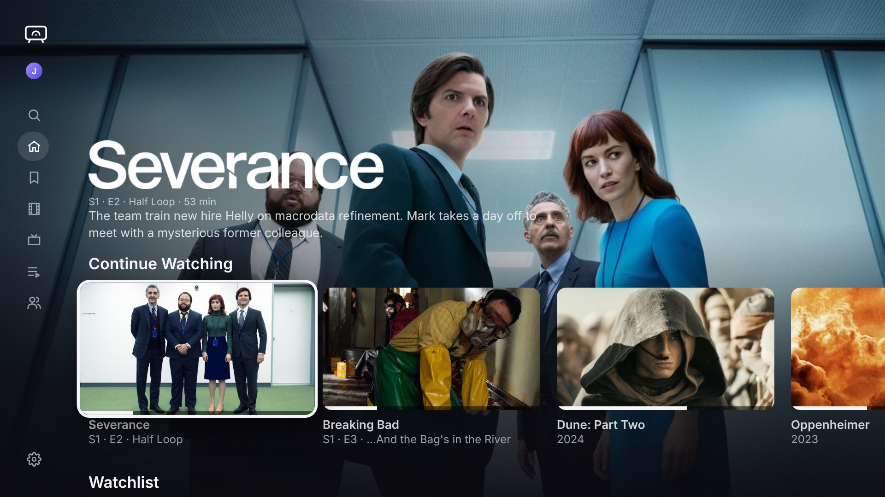
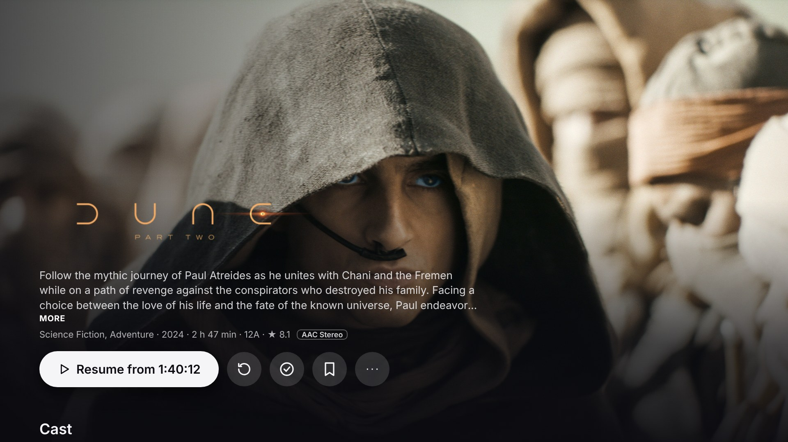
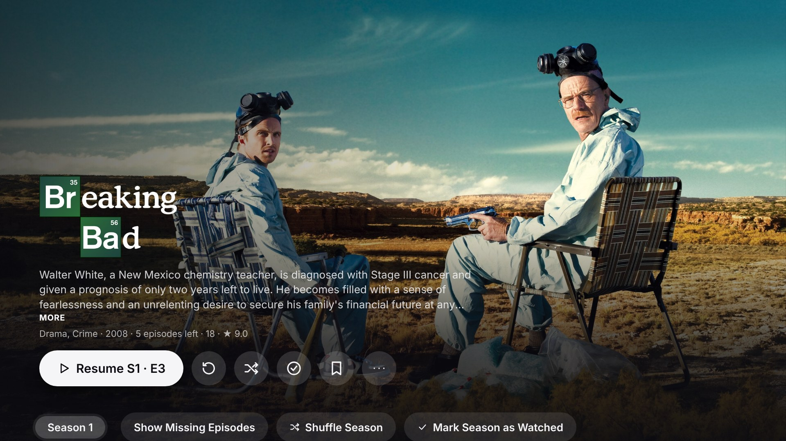
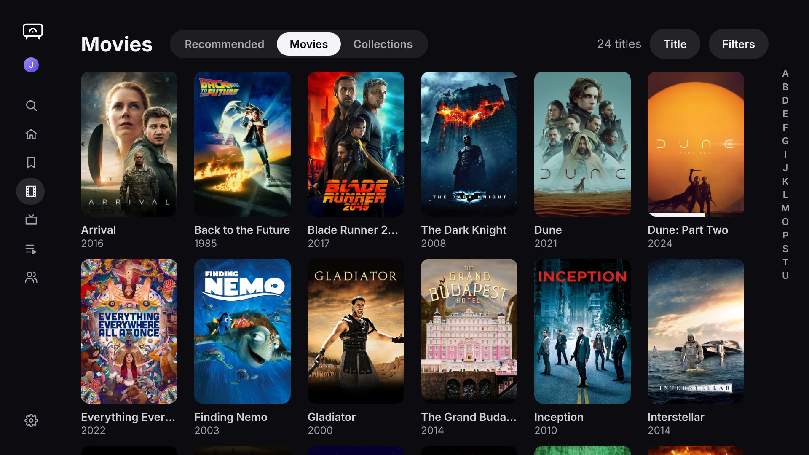
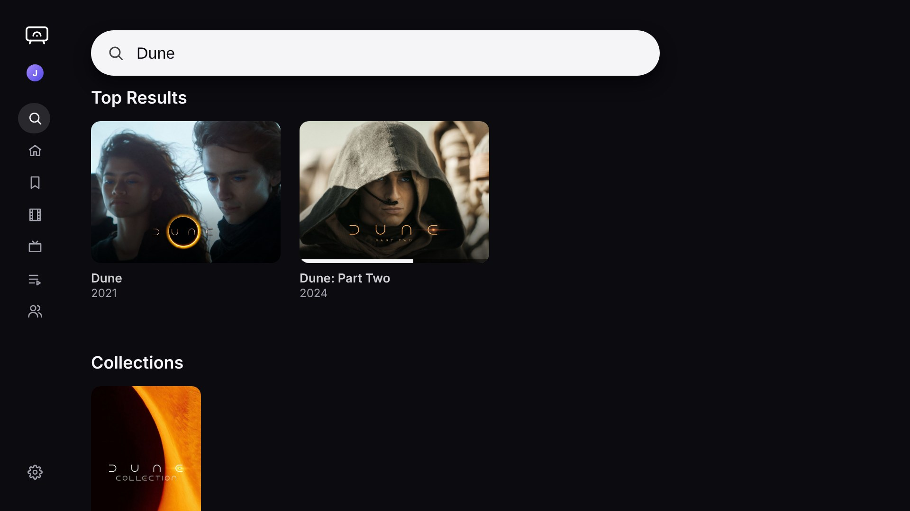
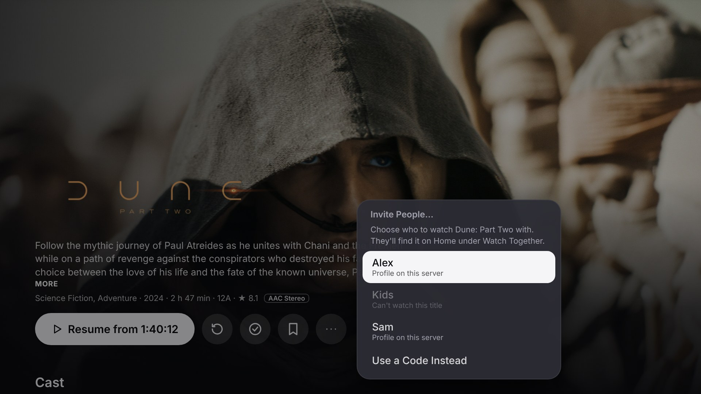
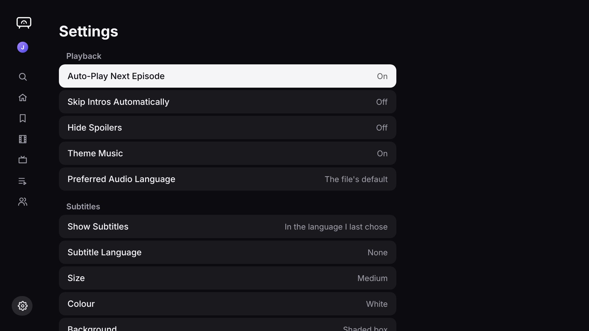
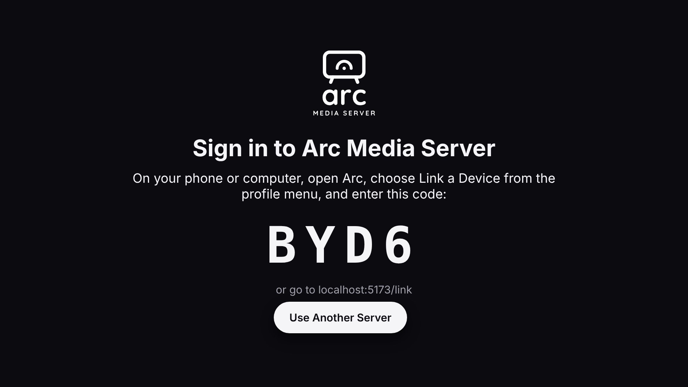
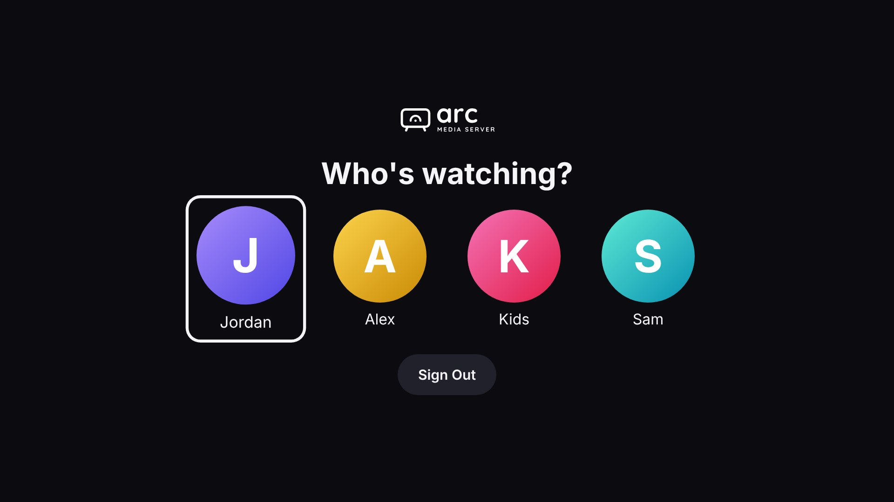

<p align="center">
  <picture>
    <source media="(prefers-color-scheme: dark)" srcset="docs/brand/arc-logo-stacked-white.svg">
    
  </picture>
</p>

<p align="center">
  <strong>Arc for LG and Samsung TVs: your Arc library on the big screen, made for the remote.</strong>
</p>

<p align="center">
  
  
  
  
  
</p>

<p align="center">
  
</p>

## What is Arc for LG and Samsung TVs?

The [Arc Media Server](https://github.com/arc-media-server/arc-media-server) app for LG and
Samsung smart TVs. If you use Plex or Jellyfin, it's the same idea: your films and shows live on
your own server at home, and this app shows them on the TV, with no extra box plugged in. You
sign in once with a short code, pick who's watching, and browse with the remote.

Home, your libraries, title pages, search and the player look like Arc's other apps, and your
watch history, resume points and settings are the same everywhere. The TV's own player plays the
video, so files your TV can handle play as they are.

> **Alpha software, not yet in the LG or Samsung app stores.** You install it yourself with the
> TV's developer mode (below). It's built and tested in a browser that stands in for the TV, and
> hasn't yet been checked on every model: what plays directly, HDR and audio formats depend on
> your TV. See [what's changed](docs/changes/).

<table>
  <tr>
    <td width="50%"></td>
    <td width="50%"></td>
  </tr>
  <tr>
    <td width="50%"></td>
    <td width="50%"></td>
  </tr>
  <tr>
    <td width="50%"></td>
    <td width="50%"></td>
  </tr>
</table>

<sub>Artwork and details from <a href="https://www.themoviedb.org">TMDB</a>. Films and shows belong
to their owners; Arc doesn't include any media.</sub>

## What it does

**🏠 Artwork-led Home.** Each title's artwork, logo and summary fill the screen as you move.
Rows as you arranged them in Arc: Continue Watching or Up Next, Watch Together, each library's
Recently Added and custom rows, collections, playlists and your Queue.

**🎬 Title pages.** Play or Resume, Watched and Watchlist; cast, extras, More Like This and
collections; seasons and episodes in the order you chose in Arc, with Show Missing Episodes,
Shuffle Season and Mark Season as Watched. Theme Music plays on title pages. The ⋯ menu (or a
long press of OK on any card) has Play Next, Add to Queue, Add to Playlist…, Watch Together,
Rate… and Media Info.

**📚 Libraries you can browse.** Recommended rows, every title with Sort, Filters and an A–Z bar,
Collections, playlists, and pages for people and collections.

**🔍 Search** for films, shows, episodes, people and collections as you type.

**▶️ A player like Arc's others.** The controls in the same order as every Arc app: the
timeline with thumbnails and chapters, skip back and forward, audio and subtitle tracks,
Subtitle Timing, versions, quality, speed and playback info. Skip Intro, Recap and Credits, Up
Next with a countdown, and the play queue. Subtitles in your profile's style and language,
including picture subtitles (Arc burns them into the video).

**👨‍👩‍👧 Made for a household.** Who's watching, with PINs; Hide Spoilers, Auto-Play and
subtitle preferences that follow you to every Arc app; and Watch Together: invite people in your
household (or share a code) and everyone's player stays in step.

**🔐 Signs in with a code.** The app finds Arc on your network (or you type its address), then
shows a short code to enter in Arc's **Link a Device** on your phone or computer. No typing
passwords with the remote.

**📺 Made for the remote.** Focus is always visible, Back always goes back, and a long press of
OK opens a title's menu.

<table>
  <tr>
    <td width="50%"></td>
    <td width="50%"></td>
  </tr>
</table>

## Installing

Arc isn't in the LG Content Store or Samsung's app store yet, so for now you install it with the
TV's developer mode, from a computer on the same network. You need:

- an LG TV with webOS 4.5 or newer (2019 models onwards), or a Samsung TV with Tizen 5.5 or newer
  (2020 models onwards);
- an Arc server the TV can reach;
- a computer with Node.js 22 or newer to build the app (`npm install` once in this folder).

### LG (webOS): the `.ipk`

1. Make a free account on LG's developer site. On the TV, install **Developer Mode** from the LG
   Content Store, sign in with that account and turn Dev Mode on. (Dev Mode runs out after a
   while; extend it in the same app.)
2. On the computer, install LG's command-line tools, ares-cli: `npm i -g @webos-tools/cli`. Add
   the TV with `ares-setup-device`, using the passphrase the Developer Mode app shows.
3. Build and install:

   ```sh
   npm run package:webos
   ares-install -d <tv> out/webos/org.arcmediaserver.tv_0.1.0_all.ipk
   ares-launch -d <tv> org.arcmediaserver.tv
   ```

### Samsung (Tizen): the `.wgt`

1. Install Tizen Studio with the TV extensions and the Samsung Certificate Extension.
2. On the TV, open **Apps**, type 12345 on the remote, turn **Developer mode** on and enter the
   computer's IP address, then restart the TV.
3. In Tizen Studio's Device Manager, connect the TV; in its Certificate Manager, make a Samsung
   certificate profile that includes the TV. Certificates are yours: they never go in git.
4. Build and install:

   ```sh
   TIZEN_PROFILE=<profile name> npm run package:tizen
   sdb connect <tv ip>
   tizen install -n out/tizen/Arc.wgt -t <device>
   ```

### Signing in

Open **Arc** on the TV. It lists the Arc servers it finds on your network (port 8099); pick yours,
or type its address. Then, on your phone or computer, open Arc, choose **Link a Device** and enter
the code the TV shows.

## Playback

Arc plays with each TV's own player (LG's media pipeline, Samsung's AVPlay), so the TV does the
decoding. The app tells Arc what the TV can play, and Arc picks the lightest way to send each file:

1. **Direct play:** the original file, untouched, when the TV can play it.
2. **Repackaged:** the same video and audio in a container the TV accepts.
3. **Converted:** Arc converts what the TV can't play, or to fit the quality you picked.

If the TV fails to play what it said it could, the app asks Arc once for the next step down
(direct play to repackaged, repackaged to converted), so a title still plays. **Playback info**
in the player says which way a title is playing and why. Your quality choice and the server's
limits still apply. HDR10 and HLG are offered on 4K sets; Dolby Vision stays off until it's been
tested on a real TV.

## For developers

### Layout

```
src/                  shared app: screens, focus navigation (Enact Spotlight), API client, text
src/platform/
  types.ts            what the app needs from a TV
  webos.ts            LG: <video> player, Back key 461, Luna calls (model, network, version)
  tizen.ts            Samsung: AVPlay player, Back key 10009, media keys, webapis
  browser.ts          desktop Chrome stand-in with hls.js, for quick UI work
src/locales/en.json   all UI text (through t())
src/assets/brand/     Arc's logo SVGs, copied unchanged from arc-media-server docs/brand
platforms/webos/      appinfo.json, icons, splash  -> npm run package:webos -> .ipk
platforms/tizen/      config.xml, icon             -> npm run package:tizen -> .wgt
scripts/              packaging, the bundle check, tests, make-logos.mjs (the icons and splash)
docs/brand/           the README's logos (the same SVGs, plus the black one for light mode)
docs/screenshots/     the README's pictures
docs/changes/         one note per change
```

The build picks the platform file at compile time (`vite build --mode webos|tizen|browser`), so
each package carries only its own code. The app talks to Arc only through `/api/v1`.

**Chrome 53:** the oldest supported sets, LG's 2019 TVs (webOS 4.5, such as the C9), run a
Chrome 53 engine and load packaged apps from `file://`. So the bundle targets Chrome 53, includes
core-js and an AbortController polyfill for missing built-ins, and is one classic script (module
scripts are refused from `file://`); no CSS grid or flex `gap`. `npm run check` fails if either
TV bundle uses newer syntax.

### Develop

```sh
npm install
npm run dev                 # desktop Chrome at http://localhost:5173, proxying /api to Arc on :8099
ARC_URL=http://192.168.1.10:8099 npm run dev   # or another Arc
npm run check               # types, the Watch Together and Subtitle Timing tests, both TV builds
                            # and the old-TV syntax check
```

In the browser, arrow keys and Enter move like the remote, holding Enter (or a right-click) is a
long press, Escape or Backspace is Back, and Space is play/pause. Most UI work happens here; check
layout and keys in the TV simulators, and playback on a real TV (the emulators have no real
decoders). Develop against a scratch Arc, never a server with your own library on it.

**The README's pictures come from this browser build, not from a TV.** They were taken at
1920×1080 against Arc's shared screenshot library (arc-media-server's `docs/SCREENSHOTS.md`): a
throwaway server whose titles are matched on TMDB, signed in with a link code as Jordan, and
driven with the remote's keys.

### Still to check on real TVs

Kept as a list until each is shown on a real set (no device claims without evidence):

- Cross-origin calls from the packaged app to Arc (webOS file origin; Tizen `<access>` rules).
- The capability tables in `webos.ts` and `tizen.ts` per model year: MKV direct play, HEVC 10-bit,
  HDR10/HLG/HDR10+, AV1, DTS, and Dolby Vision on LG (left off until tested).
- AVPlay start and seek with Arc's converted (HLS, fMP4) streams.
- Which webOS ACG groups (`requiredACG` in appinfo.json) the model-name and network-status Luna
  calls need on newer webOS; without them the app still works but can't find servers itself.
- Subtitle timing and size on each TV's player; picture subtitles (burned in by Arc).
- Focus, scrolling and artwork speed on the C9's Chrome 53 engine.

## Licence

AGPL-3.0-only, copyright "The Arc Media Server Authors". See [LICENSE](LICENSE).
